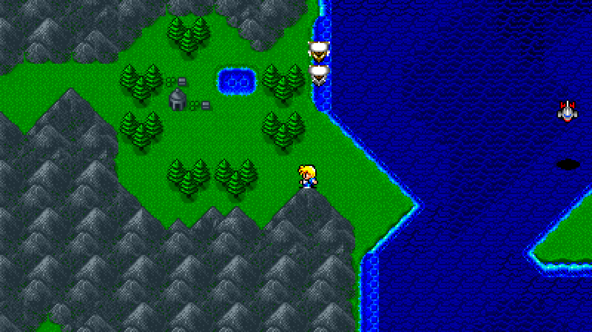
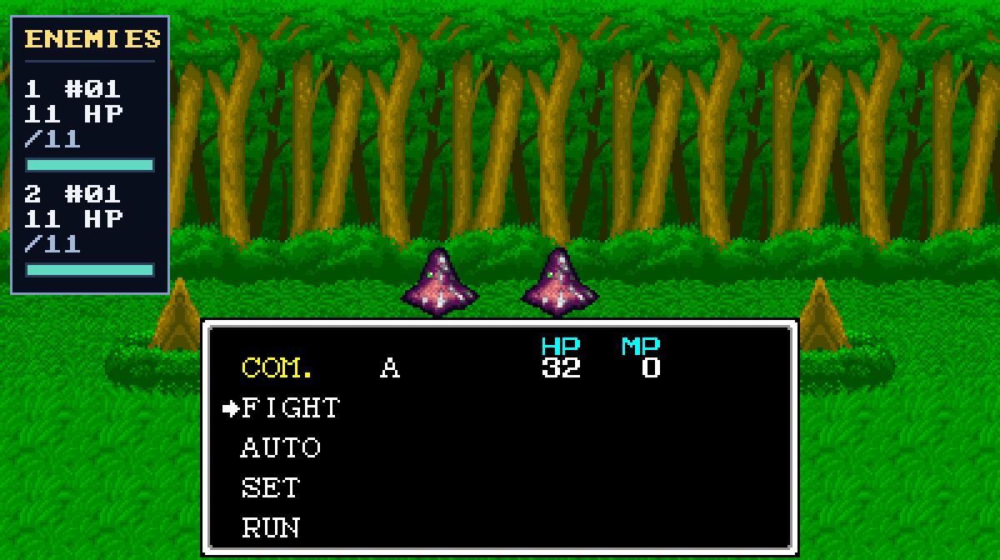
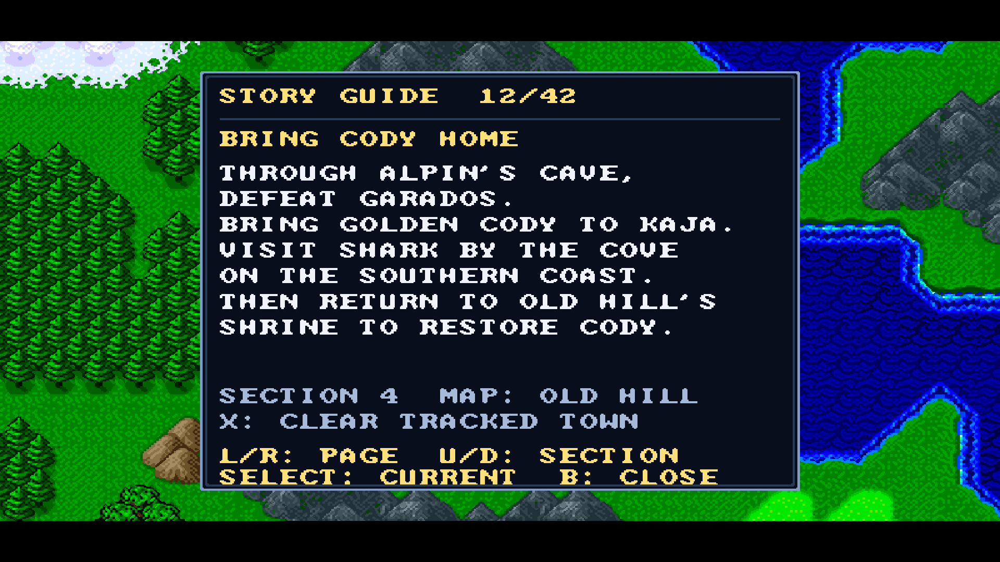
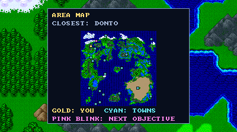

# Secret of the Stars Companion

**A Windows PC-port foundation for Tecmo Secret of the Stars, with a Companion launcher, controller support, enhanced pixel art and experimental widescreen.**

[](ROADMAP.md)
[](BUILDING.md)
[](docs/VALIDATION.md)

**Latest development: native 0.5.0 / Companion 0.3.6.** Original callbacks complete before source-certified native instructions; guarded active travel sprite offsets extend the rendering family. Full Guide/Current, maps and QoL remain. [Current scope](docs/FOUNDATION-NATIVE-HOOK-TRAVEL-OFFSETS-2026-10-12.md). Complete native/AOT execution remains unfinished.

**Discord:** chrono.trigger

> [!IMPORTANT]
> Bring your own clean, unheadered **Tecmo Secret of the Stars (USA)** ROM. This repository contains authored source, development tools, documentation and six reviewed feature screenshots. **No ROM, generated game code, extracted art, soundtrack, save, checkpoint or playable game binary is included.** Your game data stays local.

> [!NOTE]
> **Early development: native foundation 0.5.0 / Companion 0.3.6.** A local Windows build runs opening gameplay, menus and combat, with focused implementation checks. This is **not yet a complete native/AOT recompilation or a full-campaign-qualified widescreen port**. Substantial guest execution still uses the pinned SNES runtime's interpreter. HLE host staging and native presentation enhancements do not change that coverage claim.

The journal has two views: **Current** offers automatic chapter advice and finer current-state leads for your checkpoint, and **Guide** lets you browse the full story walkthrough. Its suggested starting section follows the original current chapter; it does not automatically recognize every quest step or record completion. The owner and play testers are checking campaign directions. The [preceding Kaja/Bonzley update](docs/FOUNDATION-KAJA-BONZLEY-2026-10-12.md) retains the bounded automatic advice and verified map destinations.

The aim is to give this overlooked RPG a polished PC edition that is easier to play and easier to understand: attractive original pixel art, a genuinely wider world view, reliable controls and audio, a useful quest journal, and a map showing your position, towns and verified destinations. The launcher follows the familiar Companion approach used in [EarthBound Companion](https://github.com/rages4calm/earthbound-companion) and [Zelda Companion](https://github.com/rages4calm/zelda-companion).

## PC feature screenshots

These are actual captures of features added for this PC project. **[View all six screenshots and captions](docs/FEATURE-GALLERY.md)**, including configurable rewards, movement and keyboard/controller hotkeys.



*Guarded wider scenery and original vehicle rendering.*



*Toggleable enemy HP information alongside the battle view.*



*Browse the full story guide and track a named town while the game runs.*



*Captured from the running game at 1080p with enhanced pixels and widescreen enabled. Gold shows your position, cyan marks towns, and the pink marker blinks at the town selected from the guide.*

The gameplay images use isolated development checkpoints. Widescreen is optional and uses the original view where a scene is not qualified; the manually browsable story guide now covers the ending, while automatic event advice remains bounded. Upscaling preserves original artwork. See the gallery for exact capture scope and example launcher settings.

The [0.3.6 encounter update](docs/FOUNDATION-ENCOUNTER-RATE-2026-10-11.md) adds a 0–100% random encounter setting in Companion 0.3.5. Default 100% retains the original check; 0% disables qualified ordinary random battles while scripted battles retain their separate original path. The setting narrows integer bins in the original threshold, so a reduced value does not promise an exact campaign fight frequency.

The preceding [0.3.5 continuation](docs/FOUNDATION-CIRCUS-PRIEST-2026-10-11.md) adds circus-ticket guidance, the current Cody/priest request and a verified Decatas world-map destination. Companion remains 0.3.4. Exact overlay, map, original-loader graphics, launcher and finite playback checks have separate reports; initial failed tests and the intermittent modal audio limitation remain explicit. The [0.3.4 source continuation](docs/FOUNDATION-REVIEWED-ROOTS-2026-10-11.md) retains the reviewed generation available through normal Setup using only your owned ROM and public source.

## What works today

| Area | Implemented behavior | Current limit |
| --- | --- | --- |
| Windows foundation | Compiled C/SDL3 host with native game-specific enhancements and guarded original execution | Complete native/AOT game execution is still future work |
| Companion launcher | ROM validation, source-build progress/cancellation, isolated profile updates/rollback, explicit title/selected-copy resume and protected settings edits; downloadable ROM-free WIP launcher/source package | Requires your owned ROM and Windows development tools to build the native game |
| Enhanced pixels | Independently selectable Scale2x presentation, exact window sizes, pixel shape and fullscreen output | Upscaling preserves original artwork; it is not a replacement HD world pack |
| Widescreen scenery | Stable 400-pixel canvas, selected original primary/secondary map resources, title panorama and sixteen authored battle-side layouts using original cells | Original 256-pixel center stays exact; selected overworld edge crossings retain terrain margins; unsupported states retain centered imagery and side bars |
| Widescreen actors | Ordinary party, regular/reserved packets, guarded driving/parked and selected compound vehicle rosters, and selected later world-map actors, plus a shared ordinary wrapped-map family across compatible parties and NPC rosters, with bounded original variable effects | Original allocation, packet and art checks authenticate supported contexts; ambiguous anchors, nonzero large/travel offsets and incompatible layouts retain fallback |
| Controls | Editable keyboard/controller game buttons and hotkeys, twenty checkpoint bindings, fullscreen and reachable HUD/journal/rewind controls | Broader physical-controller testing remains open |
| Menu and battle QoL | Optional faster field menus and toggleable HP bars with a widescreen battle sidebar | The HP panel is an authored enhancement, not a bundled ROM hack |
| Rewards and travel | Independently adjustable 1–10× battle XP/gold; bindable 1–3× field movement boost; 0–100% ordinary random encounter modifier; hold/toggle fast-forward | Movement and encounters use guarded original seams; unsupported contexts retain original behavior and scripted battles stay enabled |
| Quest journal | Full 42-page / 14-section story guide, coarse current-chapter starting suggestions and existing checkpoint-specific advice; configurable J / left-stick click opener | Game X can manually track an explicitly named town; guidance is not automatic campaign event detection or completion history; owner/play testers verify campaign directions |
| Navigation map | Original current-area terrain and your position; original world towns, automatic verified destinations and player-selected guide-town tracking; M / Back + left-stick click | Unsupported areas use a clear fallback; no exploration history or guessed objective coordinates |
| Audio and stability | Original SNES audio, cached host composition, repaired mosaic overrun and checked audio/OpenGL allocations | Finite paced GPU/audio routes pass; every cutscene and hardware configuration is not certified |
| Saves and rollback | Guarded checkpoint loading, restore/cache reset and protected copied-save testing | Local state schemas are build-specific; test on copies and keep in-game saves backed up |

**Widescreen is experimental and defaults off.** It expands scenery and observed actors without spawning extra actors or changing collision, activation or game speed.

## Build from your own ROM

[Download the WIP launcher/source package](https://github.com/rages4calm/secret-of-the-stars-companion/releases), extract it and open **Start Secret of the Stars Companion.cmd**. Its Setup page validates your owned ROM and builds the native game locally. The package includes the launcher, authored source and notices; it does not include a playable game binary or original game data. Install the prerequisites in [BUILDING.md](BUILDING.md) first.

Developers can also build from this source snapshot:

```powershell
git clone https://github.com/rages4calm/secret-of-the-stars-companion.git
cd secret-of-the-stars-companion
python tools/build_public_foundation.py --rom "D:\My Games\Secret of the Stars (USA).sfc"
```

The helper fetches the pinned runtime, applies thirteen separately checked patches, and uses the standard analyzer/emitter with authored reviewed entry metadata and proved instruction prefixes. It generates game code locally, compiles a fresh native executable and creates an isolated profile under ignored `local/`. No private recordings are required by normal Setup. It does not copy your ROM, replace your existing installation or manufacture a passing gameplay receipt. Existing modified runtime checkouts are preserved rather than reset.

Build the self-contained launcher with `python tools/build_public_companion.py`, then open `Start Secret of the Stars Companion.cmd` or the generated Companion EXE. Its Setup page validates your ROM and builds/adopts a fresh native profile without private gameplay fixtures. See [BUILDING.md](BUILDING.md). Historical native preview scripts and fixture checkers remain development adapters.

In **Enhancements**, 100% means the original XP/gold payout; 200% means 2×. Movement boost defaults to **Left Shift / controller L2**, and fast-forward to **Tab / controller R2**. Change these and other bindings in **Controls** and **Hotkeys**; fast-forward can be held or toggled. Existing custom profile bindings are retained. [QoL implementation and limits](docs/FOUNDATION-QOL-2026-10-09.md).

Companion **0.3.6** explains the full story guide in **Enhancements**. Open the journal with **J / left-stick click** by default. **Select** switches Current / Guide; **Left / Right** changes page; **Up / Down** changes section; **Game B** closes. **Game X** tracks or clears a town on a mapped guide page; open the Map afterward. These follow your configured game-button bindings, so Game B may be a different physical controller button. Browsing reserves those controls for the panel while the game continues running.

Companion **0.3.5** adds **Random encounter rate (%)** under **Battle rewards and travel**. Close the game, choose 0–100 and Apply; Revert restores the loaded choice. Missing settings default to 100, and Original View uses 100 for that launch without changing your saved value. The control requires native 0.3.6; older builds show an update hint.

Companion **0.3.3** adds Auto and 720p–4K window sizes, preserves custom sizes, and offers **Original CRT shape / Square pixels / Square frame**. Apply validates changed values; Revert restores the loaded profile. These controls preserve sound, rewards and bindings, and do not add scenery.

Companion **0.3.2** adds map and objective-marker settings and an assignable Map action. Missing bindings use **M / Back + left-stick click** unless that exact shortcut is already occupied. Existing explicit bindings win. Map and journal panels close each other.

Companion **0.3.1** added **Original pixels / Enhanced pixels / Experimental widescreen** display choices, **Revert changes**, current fullscreen/hotkey hints and a journal item-summary setting. Presets preserve sound, rewards and custom bindings.

Companion 0.3.0 adds **Update selected profile** and **Use previous profile** in Setup. Updates create a new isolated folder with checked copies of settings/saves; rollback selects the retained earlier folder and preserves newer progress separately. Different native builds require compatible save declarations and matching execution-state ABI. A ROM-free source-first ZIP can bundle the self-contained GUI, authored source and notices; native game compilation still needs the documented tools. [Packaging instructions](BUILDING.md#package-the-source-first-launcher) · [Update and package qualification](docs/FOUNDATION-PACKAGE-UPDATES-2026-10-09.md).

## Verification and remaining work

The installed **native 0.5.0 / unchanged Companion 0.3.6** passes focused native callback execution, source-derived travel rendering, keyboard/virtual-controller and finite D3D11/audio checks. [Scope and fallback](docs/FOUNDATION-NATIVE-HOOK-TRAVEL-OFFSETS-2026-10-12.md). Campaign verification belongs to the owner and play testers.

The full guide draws on credited written walkthroughs; automatic Current chapter reminders retain the finer source-backed opening-through-Sidon leads. The map keeps its independent automatic destinations and now supports explicit guide-town choices. Current possession is not permanent quest history, and browsing a later page does not mark anything complete. Owner and play testers verify the campaign and report corrections.

A new source build receives its own hash and receipt. Compilation, focused execution, playback, installation and packaging are separate checks; none transfers another executable's qualification. Native 0.4.0 changes the declared execution-state ABI, so strict source-profile update refuses 0.3.9 to 0.4.0. Fresh source adoption is available. Selected legacy checkpoint resumes worked in focused checks; the declaration mismatch alone does not prove incompatible serialization. See [BUILDING.md](BUILDING.md).

Complete native/AOT execution, broader original story/party/effect rendering and hardware coverage remain open. Widescreen retains guarded fallback, and the replacement HD artwork pack is deferred. [Roadmap](ROADMAP.md) · [Validation boundaries](docs/VALIDATION.md). Historical foundation documents keep their dated limits; private development reports and inputs are not published.

## Contribute

Small, focused contributions are welcome: renderer fixes, reverse-engineering notes, controller checks, bounded replay tools, verified journal events and documentation. Please report a reproducible route rather than feeling obliged to play the whole game again. [Contribution guide](CONTRIBUTING.md) · [Report a bug](https://github.com/rages4calm/secret-of-the-stars-companion/issues/new?template=bug-report.yml).

Never attach ROMs, generated ROM-derived code, extracted packs, soundtrack audio, private saves or unlicensed cached hack source to an issue or pull request. Keep copyright/provenance notices intact and separate observed facts from hypotheses.

## Credits and licensing

Built on **[RetroPortingToolKit/snesrecomp](https://github.com/RetroPortingToolKit/snesrecomp), by Matthew Stanley and contributors**, with the runtime's retained snesrev, LakeSnes and other upstream lineage. Scale2x credit goes to **Andrea Mazzoleni**. The launcher reuses Carl Prewitt Jr.'s MIT-licensed EarthBound Companion UI patterns; Zelda Companion informed the workflow and presentation direction. Tecmo and the original game's creators/rightsholders deserve the game credit.

This is an unofficial fan project with no affiliation or endorsement from Tecmo or the original game's rightsholders. Project licenses do not grant rights to original game content.

The native foundation, runtime patch, project tools and documentation are **source available under PolyForm Noncommercial 1.0.0**, with retained third-party exceptions. Companion code is **MIT**. This repository is not uniformly MIT licensed. [Credits](CREDITS.md) · [License](LICENSE) · [Third-party notices](THIRD_PARTY_NOTICES.md).
