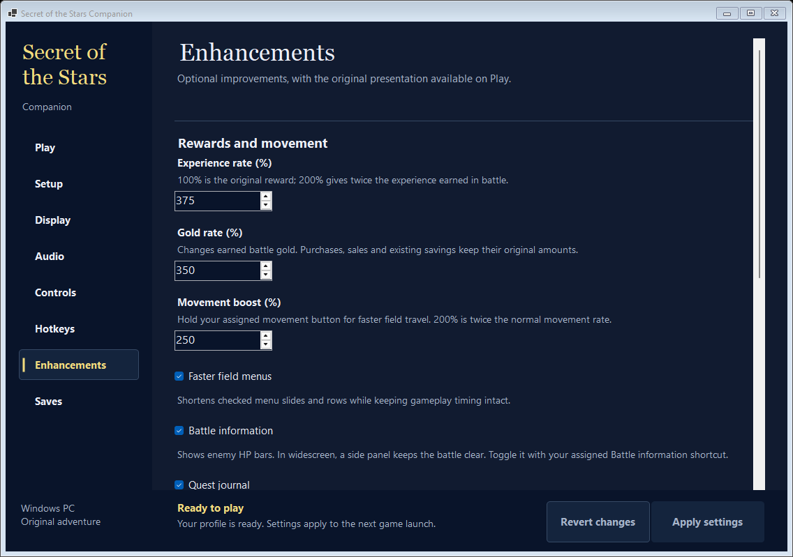
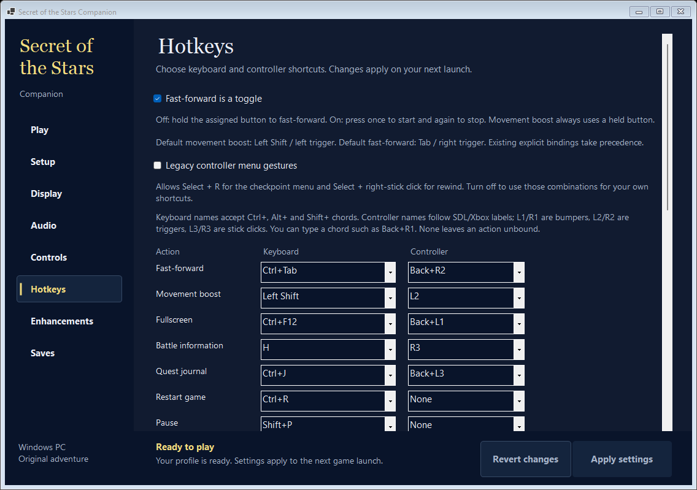

# Secret of the Stars: PC feature gallery

Six actual captures: five from native **0.2.5** / Companion **0.3.1**, plus the navigation map from native **0.2.7**. These show additions to the original SNES release: wider scenery, a battle HP sidebar, quest guidance, adjustable rewards and movement, and configurable PC/controller hotkeys.

This is an early playable foundation. Complete native/AOT game execution and full-campaign widescreen coverage remain unfinished. Gameplay captures use isolated development checkpoints; launcher captures show example settings. Original artwork belongs to the game's rightsholders; no extracted art pack or game data is distributed here.

## Wider world, including original vehicles

A true 400-pixel scene shows terrain and an original parked vehicle beyond the original viewport. Selected-resource, completed-packet and raster guards preserve the original center; unsupported scenes use the original view. This is an isolated staged development checkpoint, not a naturally completed campaign.

## Battle health at a glance

The optional native battle sidebar displays enemy HP and health bars beside the original battle view. Hide or show it with your assigned keyboard/controller action in Companion Hotkeys. The redundant HUD-key footer has been removed.

## Quest directions while the game runs

The journal shows an objective, route advice and current progress from verified original dialogue and flags. This Mayor/Ringo clue was executed through the original event after a staged chapter prerequisite. Further chapters and permanent quest history remain in development.

## Choose your own pace

Separate XP and gold modifiers range from 100% to 1000%; held ordinary movement boost ranges from 100% to 300%. Faster menus, enemy HP information and the journal are configurable. These are example settings from an isolated profile.

## Keyboard and controller hotkeys

Assign fullscreen, HUD, journal, movement boost, checkpoints and more to keyboard/controller actions. Fast-forward supports hold or toggle. These are example custom bindings; game-button mapping has its own Controls page.

[Build from your own ROM](../BUILDING.md) · [Current implementation and validation limits](FOUNDATION-CONTINUATION-2026-10-11.md) · [Capture hashes and provenance](screenshots/captures.json).

## Position, towns and a verified destination

Gold marks your position, cyan marks original town entrances, and the optional
pink destination blinks. The legend text matches those marker colors. This is
actual native0.2.7 output from a copied original
Morgan payment/world-return route with staged prerequisites. The terrain,
position and Decatas marker are checked independently against original data.
Local maps show current-area terrain and position. Assigned Map bindings and the
objective toggle live in Companion. The preceding five images retain their
native0.2.5/Companion0.3.1 capture scope.
